# Doctor Tracker Frontend (Admin Portal)

> Production-grade Next.js 16 (App Router) administrative web portal for managing doctors, patient records, and real-time practice analytics. Features React Server Components (RSC), Turbopack, Tailwind CSS v4, Recharts data visualizers, and resilient session management.

---

## Table of Contents
1. [Overview & Description](#overview--description)
2. [Visual Evidence (Screenshots)](#visual-evidence-screenshots)
   - [1. Authentication (Login)](#1-authentication-login)
   - [2. Analytics Dashboard](#2-analytics-dashboard)
   - [3. Doctor Management](#3-doctor-management)
   - [4. Doctor Detail & Patient Roster](#4-doctor-detail--patient-roster)
   - [5. Patient Management](#5-patient-management)
3. [Setup Guide](#setup-guide)
   - [Prerequisites](#prerequisites)
   - [Installation](#installation)
   - [Environment Variables (.env.local)](#environment-variables-envlocal)
   - [Development & Production Commands](#development--production-commands)
4. [System Architecture](#system-architecture)
   - [RSC vs. Client Data Flow](#rsc-vs-client-data-flow)
   - [API Integration & Token Forwarding](#api-integration--token-forwarding)
   - [Directory Structure](#directory-structure)
5. [Technical Decisions Deep Dive](#technical-decisions-deep-dive)
   - [Decision 1: httpOnly Cookie Delegation via Next.js Proxy/SSR](#decision-1-httponly-cookie-delegation-via-nextjs-proxyssr)
   - [Decision 2: Recharts Server Component Aggregation over Client Processing](#decision-2-recharts-server-component-aggregation-over-client-processing)
6. [Performance & Optimization](#performance--optimization)
7. [UI / UX Implementation Notes](#ui--ux-implementation-notes)
8. [Quality Gates & Testing](#quality-gates--testing)

---

## Overview & Description

The Doctor Tracker Frontend provides an intuitive, high-density administrative interface for healthcare operations. Key architectural highlights:
- **Server-Driven Architecture**: Next.js React Server Components fetch data on the server with minimal JavaScript shipped to the client.
- **Resilient Authentication**: Secure cookie delegation with Next.js Middleware/Proxy, automatic token refresh deduplication, and safe post-login redirection.
- **Instantaneous Search & Pagination**: URL search parameter synchronization for shareable, bookmarkable, and history-friendly filtering.
- **Asynchronous Data Pickers**: Remote doctor assignment pickers with on-demand debounced search, avoiding massive upfront dropdown loads.
- **Accessible & Responsive**: Fully fluid from 375px mobile viewports up to 4K displays with accessible modal dialogues and keyboard navigation.

---

## Visual Evidence (Screenshots)

Captured directly from the live running application:

### 1. Authentication (Login)
*Desktop (1440x900) & Mobile (375x812)*

| Desktop View | Mobile View |
| :---: | :---: |
| 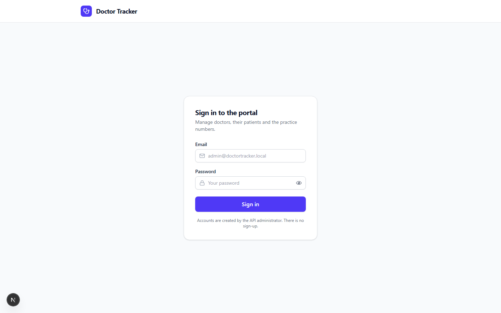 | 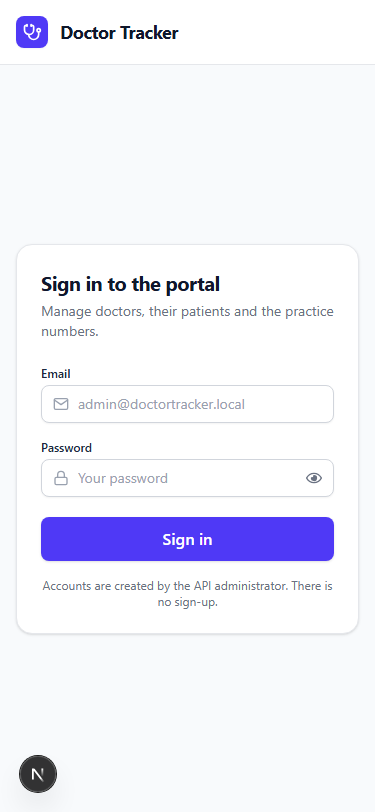 |

### 2. Analytics Dashboard
*Practice statistics, patient trends over time, condition prevalence, and doctor workloads.*

| Desktop View | Mobile View |
| :---: | :---: |
| 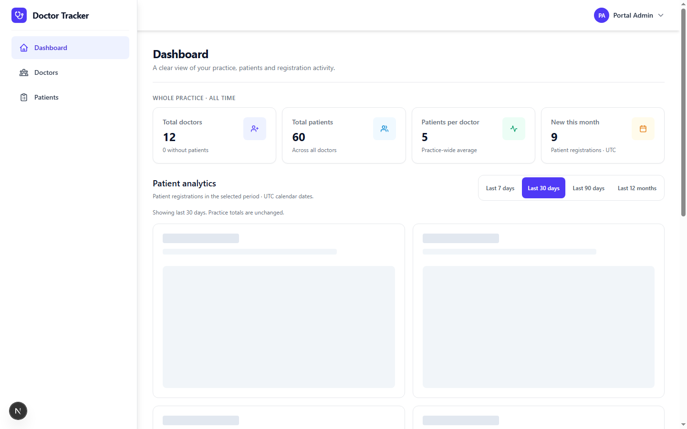 | 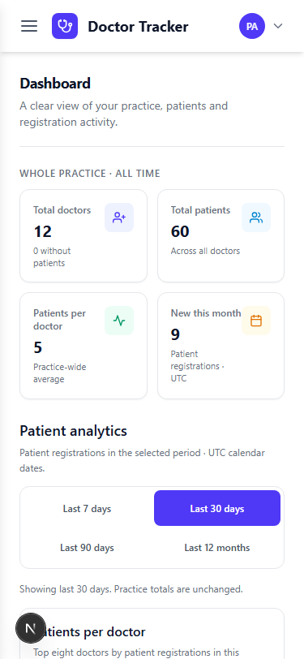 |

### 3. Doctor Management
*Doctor directory with real-time specialization filters, search, and roster counts.*

| Desktop View | Mobile View |
| :---: | :---: |
| 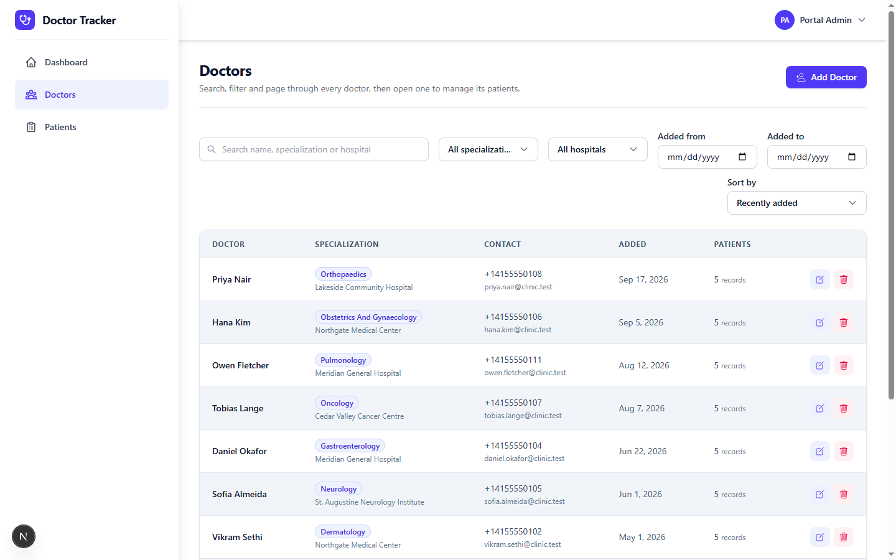 | 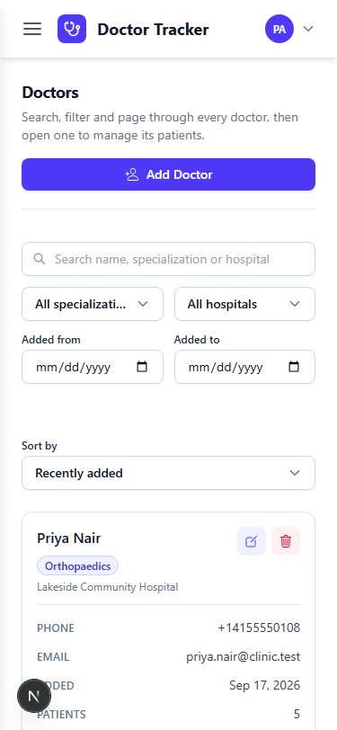 |

### 4. Doctor Detail & Patient Roster
*Detailed doctor profile and their assigned patient sub-roster with active status badges.*

| Desktop View | Mobile View |
| :---: | :---: |
| 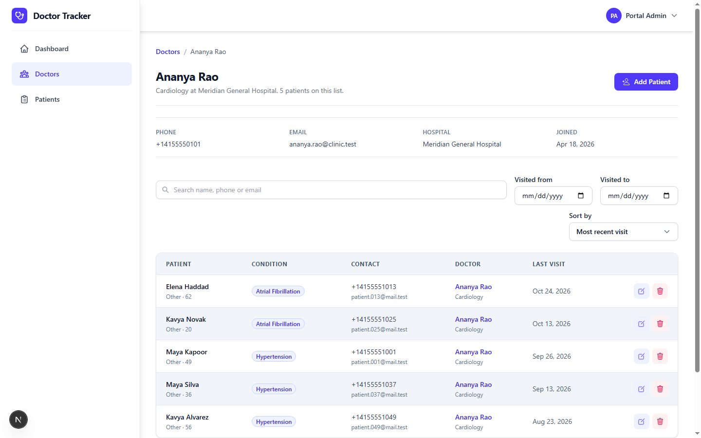 | 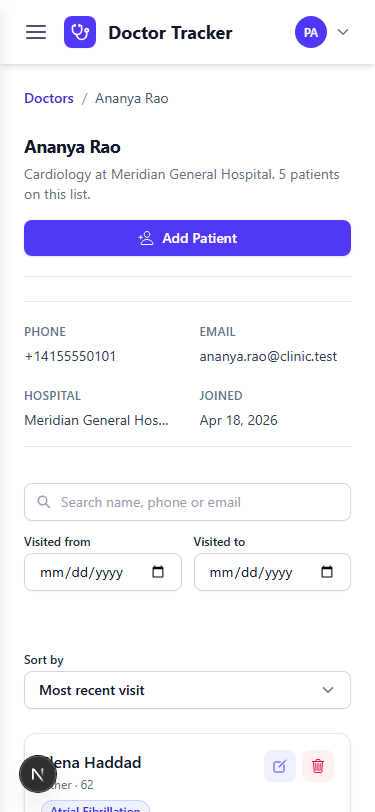 |

### 5. Patient Management
*Centralized patient list with doctor relationships, condition filters, and quick edit modals.*

| Desktop View | Mobile View |
| :---: | :---: |
| 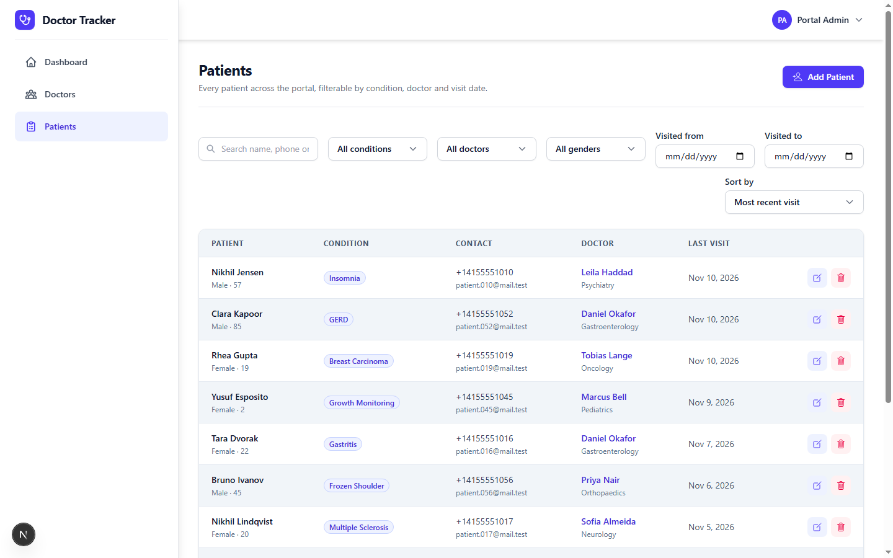 | 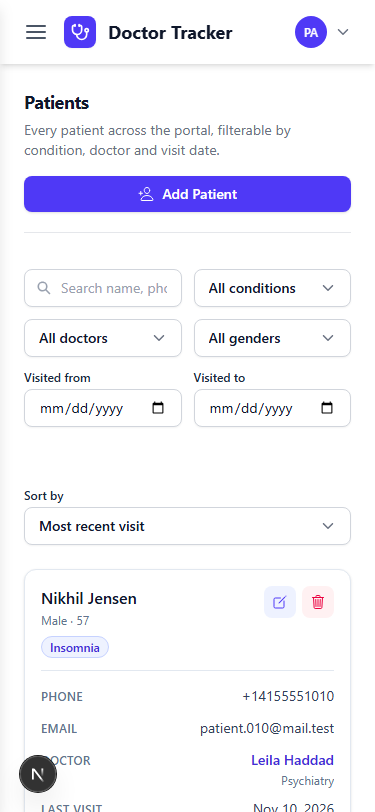 |

---

## Setup Guide

### Prerequisites
- **Node.js**: `v20.0.0` or higher (`node -v`)
- **npm**: `v10.0.0` or higher (`npm -v`)
- **Backend API**: The Doctor Tracker backend running on `http://localhost:5000`

### Installation

1. Navigate to the frontend directory:
   ```bash
   cd doctor-tracker-frontend
   ```
2. Install project dependencies:
   ```bash
   npm install
   ```
3. Configure environment variables:
   ```bash
   cp .env.example .env.local
   ```

### Environment Variables (.env.local)

| Variable | Required | Default / Example | Purpose |
| :--- | :---: | :--- | :--- |
| `API_INTERNAL_URL` | Yes | `http://localhost:5000` | Server-to-server URL used by React Server Components |
| `NEXT_PUBLIC_API_URL` | Yes | `http://localhost:5000` | Browser-accessible base URL for client-side fetches |

### Development & Production Commands

- **Start Development Server** (Turbopack enabled):
  ```bash
  npm run dev
  # Accessible at http://localhost:3000
  ```
- **Type Checking**:
  ```bash
  npm run typecheck
  ```
- **Linting**:
  ```bash
  npm run lint
  ```
- **Production Build & Launch**:
  ```bash
  npm run build
  npm start
  ```

---

## System Architecture

### RSC vs. Client Data Flow

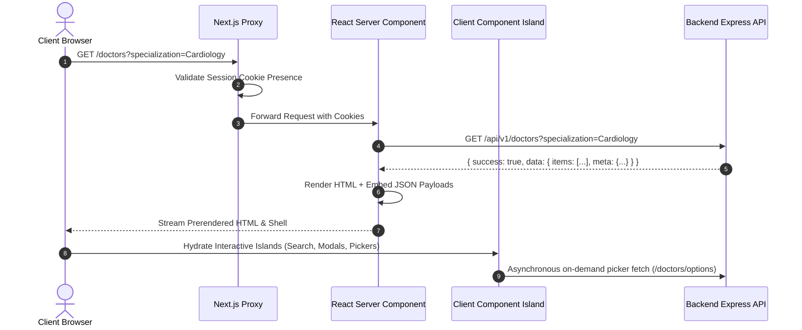

### Directory Structure

```
doctor-tracker-frontend/
├── src/
│   ├── app/                           # Next.js App Router root
│   │   ├── layout.tsx                 # Root layout with shared navigation & header
│   │   ├── page.tsx                   # Dashboard route (RSC with metrics & Recharts)
│   │   ├── login/                     # Authentication login page
│   │   ├── doctors/                   # Doctor directory and [id] sub-detail roster routes
│   │   └── patients/                  # Patient directory and filters
│   ├── components/
│   │   ├── charts/                    # Client visualizers (Recharts bar, pie, line charts)
│   │   ├── doctors/                   # Doctor table, create/edit modals, filter bar
│   │   ├── patients/                  # Patient table, assignment modals, status chips
│   │   └── ui/                        # Reusable primitives (Buttons, Modals, Badges, Inputs)
│   ├── lib/
│   │   ├── api.ts                     # Universal typed API client (RSC & Browser aware)
│   │   ├── auth-client.ts             # Client-side session bootstrap & token rotation
│   │   └── safe-redirect.ts           # Whitelisted redirect URI sanitization
│   └── proxy.ts                       # Edge authentication proxy & session routing
├── public/
│   └── screenshots/                   # Visual evidence PNG screenshots
├── docs/
│   └── screenshots/                   # Mirrored documentation screenshots
├── scripts/
│   ├── auth-client.test.mjs           # Session bootstrap test suite
│   ├── doctor-options.test.mjs        # Remote picker regression tests
│   ├── proxy.test.mjs                 # Middleware proxy routing test suite
│   └── safe-redirect.test.mjs         # Redirect sanitizer test suite
├── package.json
└── tsconfig.json
```

---

## Technical Decisions Deep Dive

### Decision 1: httpOnly Cookie Delegation via Next.js Proxy/SSR

- **Context**: Accessing authenticated API resources from both Node.js React Server Components and browser client components.
- **Alternatives Considered**:
  1. *Bearer Tokens stored in browser memory/localStorage*: Exposes tokens to client-side scripts, causes flash-of-unauthenticated-content during hydration, and fails during server rendering without custom cookie bridges.
- **Chosen Solution**:
  - The browser holds httpOnly cookies set directly by the API.
  - Server Components forward the `cookie` header received from the user's browser directly to the internal API (`API_INTERNAL_URL`).
  - Next.js Proxy validates session presence before allowing navigation to protected subtrees (`/`, `/doctors`, `/patients`).
  - An in-memory bootstrap manager (`auth-client.ts`) coalesces simultaneous client component calls into a single shared refresh handshake, preventing token race conditions.

### Decision 2: Recharts Server Component Aggregation over Client Processing

- **Context**: Rendering responsive visual insights for patient registration volume, doctor workload distribution, and diagnosis mix.
- **Alternatives Considered**:
  1. *Client fetches raw patient records and aggregates locally*: Wastes bandwidth, slows mobile phones, and breaches data minimization principles.
- **Chosen Solution**:
  - The backend pre-aggregates all series via indexed database pipelines (`/api/v1/dashboard/charts?range=30d`).
  - The Next.js Server Component retrieves the compacted data points and passes them as serializable props into lazy-loaded Recharts client islands (`ResponsiveContainer`).
- **Outcome**: Zero layout shift, instantaneous chart rendering, and identical performance on low-powered mobile devices.

---

## Performance & Optimization

1. **Turbopack & Partial Prerendering**: Fast incremental page rendering with sub-second page transitions.
2. **Narrow Client Island Scope**: Only components requiring event listeners (e.g. form inputs, modals, interactive SVG charts) carry `"use client"`. The remainder renders statically on the server.
3. **Optimized Doctor Options Fetching**: Rather than pre-loading hundreds of doctor records for form selectors, `DoctorPicker` fetches 20 records at a time with debounced prefix search queries.
4. **Stable Render Keys**: Table rows use database `_id` keys to ensure that updates or row reassignments trigger localized DOM updates rather than full-table repainting.

---

## UI / UX Implementation Notes

- **Responsive Viewports**: Tested and verified across 375px (mobile), 768px (tablet), 1024px (desktop), and 1440px (wide monitor) viewports with zero horizontal overflow.
- **Mobile Tap Targets**: Interactive buttons and inputs maintain a minimum touch target size of 44x44px.
- **Keyboard Navigation & Accessibility**:
  - Modals can be dismissed using the `Escape` key or by clicking the overlay.
  - Form validation errors display inline with explicit `aria-describedby` associations.
  - Clear, accessible focus rings conform to WCAG contrast standards.

---

## Quality Gates & Testing

Run all quality checks before shipping:

```bash
# 1. Authentication and redirect security tests (27 regression tests)
npm run test:auth

# 2. Remote options picker and SSR loader tests (7 tests)
npm run test:queries

# 3. TypeScript type checking
npm run typecheck

# 4. ESLint inspection
npm run lint

# 5. Production Turbopack build
npm run build
```
